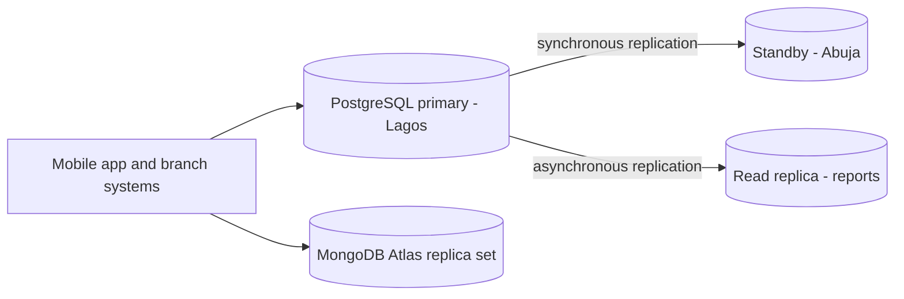

# Portfolio 5: Distributed and Cloud Database Exercise (Ace Bank)
## Overview
Ace Bank runs a relational database (PostgreSQL) for accounts and money movement, and a document database (MongoDB Atlas) for flexible customer and transaction details. This portfolio discusses how that system would be spread across several servers and cloud regions to stay available and consistent as it grows. It covers replication, sharding, availability and consistency, and it uses two pieces of evidence from this project: the MongoDB Atlas cluster and a small PostgreSQL partitioning demo.
## Files
| File | Purpose |
|---|---|
| README.md | The discussion and the evidence |
| partitioning_demo.sql | Optional demo of splitting transactions by account (the idea behind sharding) |
| Screenshots (.png) | Atlas cluster overview and the partitioning output |
## 1. Proposed deployment for Ace Bank

- **Money movement** goes to a single PostgreSQL primary in Lagos, because balances must be exact.
- A **synchronous standby** in a second city holds a copy of every committed transaction, so no committed transfer is lost if the primary fails.
- An **asynchronous read replica** serves reports and statements, so heavy queries (like Q3 in Portfolio 2) do not slow down transfers.
- **Customer profiles and transaction details** live in MongoDB Atlas, which runs as a replica set across several servers.
## 2. Replication
Replication keeps copies of the same data on more than one server.
- **PostgreSQL:** streaming replication sends every change from the primary to standby servers. Synchronous replication waits for a standby to confirm before the transfer is reported as complete, which is safer but slower. Asynchronous replication does not wait, which is faster, but the replica can lag slightly behind.
- **MongoDB:** a replica set has one primary and several secondaries that copy it. If the primary fails, the secondaries elect a new one automatically. Setting the write concern to "majority" means a write is only confirmed once most servers have it.
- **Trade-off:** more safety (synchronous or majority) means slower writes. For a bank, safety for money movement matters more than speed.
## 3. Sharding
Sharding splits one large dataset across several servers (shards), each holding part of it.
- **What Ace Bank would shard:** the transactions table, because it grows fastest (millions of rows a day in a real bank).
- **Shard key:** `account_id`, hashed. All transactions for one account stay together, so a statement query only needs one shard, and the hash spreads accounts evenly.
- **A poor key would be `created_at`:** all new transactions are written today, so one shard would receive every write (a hotspot).
- **Cost:** a query that does not include the shard key, such as "all failed transactions this week", must ask every shard. Transfers between accounts on different shards also become harder to keep consistent, which is a real challenge for banks.
## 4. Availability
Availability means the bank keeps working when something fails.
- **Failover:** if the primary fails, a standby is promoted automatically or by an operator, and the app reconnects.
- **Backups and recovery:** regular backups plus a log of changes let the database be restored to a point in time after a serious error.
- **Spread across locations:** keeping replicas in separate cities or cloud zones means one power or network failure does not stop the bank.
- **Targets:** banks set a recovery time (how fast service returns) and a data loss limit (how much recent data can be lost). Synchronous replication aims for no loss of committed transfers.
## 5. Consistency and the CAP theorem
The CAP theorem says that when a network split happens between servers, a system must choose between consistency (everyone sees the same, latest data) and availability (every request gets an answer).
| Ace Bank data | Choice | Reason |
|---|---|---|
| Account balances and transfers | Consistency first | A wrong balance or a double spend is unacceptable. It is better to refuse or delay a transfer than to risk a wrong one. |
| Customer profile and preferences | Availability first (eventual consistency is acceptable) | A change to an alert setting appearing a few seconds late harms no one. |
| Reports and analytics | Eventual consistency | Reading from a slightly delayed replica is fine for summaries. |
This matches the project: Portfolio 3 used locks and transactions in PostgreSQL to keep money consistent, and Portfolio 4 used MongoDB for flexible data where strict balance accuracy is not needed.
## 6. Evidence from this project
### 6a. Cloud deployment: MongoDB Atlas cluster
I deployed a free MongoDB Atlas cluster for Portfolio 4. Screenshot: `atlas-cluster-overview.png`.
- **Cloud provider and region shown on my cluster:** AWS / Cape Town (af-south-1)
- **Cluster type and number of nodes shown:** Replica set- 3 nodes
- **What this shows:** My Atlas cluster is a replica set of 3 servers that each hold a copy of the data. One acts as the primary, which takes the writes, and the other two are secondaries that copy it. If the primary fails, the secondaries can elect a new primary, so the data stays available. With 3 nodes, a majority is 2, which fits the “majority” write concern described in section 2: a write is confirmed once 2 of the 3 servers have it. This is replication in a real cloud deployment, the same idea as the PostgreSQL primary and standby in my proposed design.
- **Limits of the free tier:** The cluster is a small free tier cluster, and I did not test failover or sharding on it.
## 7. Summary of trade-offs
| Technique | Benefit | Cost |
|---|---|---|
| Synchronous replication | No committed transfer is lost | Slower writes |
| Asynchronous read replica | Reports do not slow transfers | Data may be slightly out of date |
| Sharding by account_id | Scales storage and writes | Cross-shard queries and transfers are harder |
| Multi-location deployment | Survives a site failure | Higher cost and complexity |
## 8. Challenges and lessons learned
[Write 2 or 3 sentences in your own words. For example, what surprised you about the trade-off between safety and speed, or why the shard key matters.]
## 9. References
- PostgreSQL documentation: High Availability, Load Balancing, and Replication; Table Partitioning. https://www.postgresql.org/docs/current/
- MongoDB Manual: Replication; Sharding. https://www.mongodb.com/docs/manual/
- Brewer, E. (2012). CAP twelve years later: How the "rules" have changed. IEEE Computer, 45(2), 23-29.
